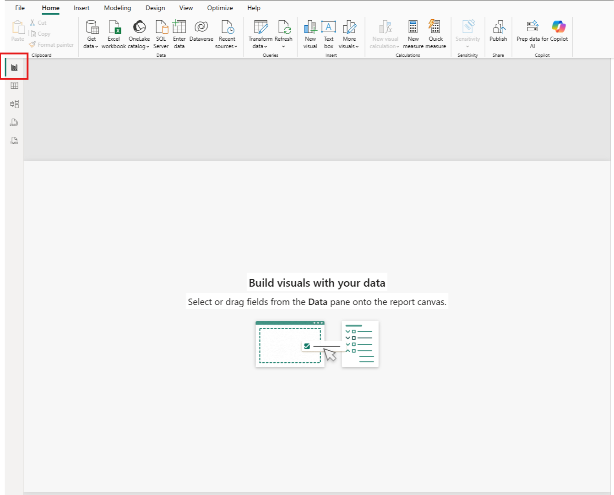
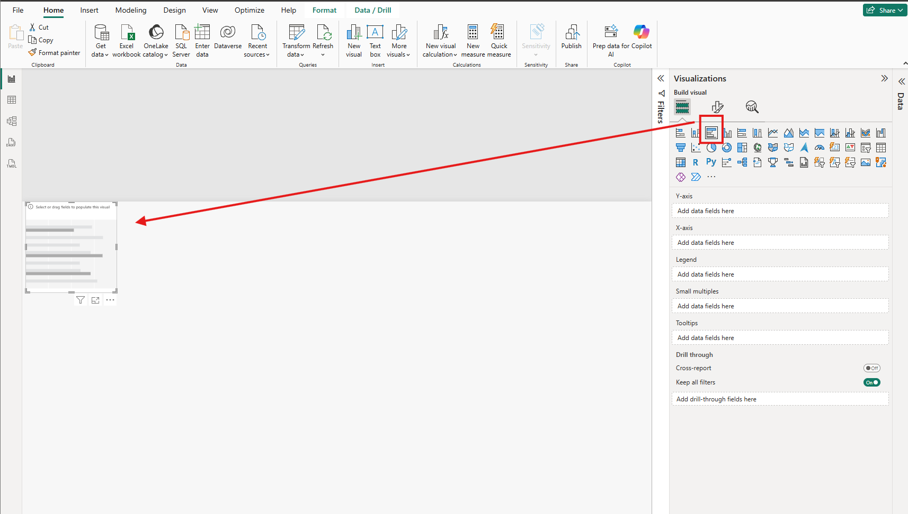
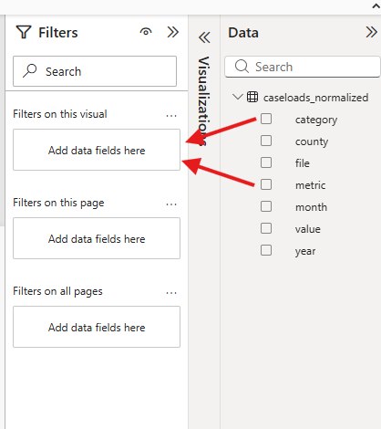
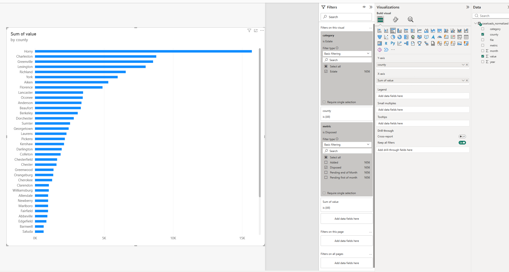
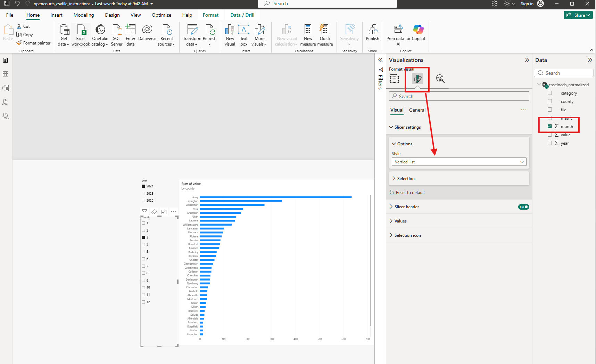

# Power BI Desktop: 5-minute setup

This guide is for **developers and analysts working from a checkout of this repo** on a Windows machine. You will load OpenCourts **Gold** caseload data into [Power BI Desktop](https://powerbi.microsoft.com/desktop/) so you can filter and chart it locally.

> [!NOTE]
> You do **not** need an OpenCourts Azure account, a Power BI Pro license, or a sign-in for this walkthrough. Everything stays on your PC (or talks only to `localhost`). This is **Power BI Desktop** only — not the Power BI Service (app.powerbi.com) or org cloud sharing.

## Contents

- [Prerequisites](#prerequisites)
- [What “Gold” means](#what-gold-means)
- [Load Gold data into Power BI](#load-gold-data-into-power-bi)
  - [Install and open Power BI Desktop](#install-and-open-power-bi-desktop)
  - [Option A — Local CSV file (fastest)](#option-a--local-csv-file-fastest)
  - [Option B — Web connector (local HTTP)](#option-b--web-connector-local-http)
- [Suggested first visual](#suggested-first-visual)
- [Refresh](#refresh)
- [Troubleshooting](#troubleshooting)

## Prerequisites

| Need | Notes |
| --- | --- |
| Windows PC | Power BI Desktop does not run on macOS/Linux. |
| This repository cloned locally | You need the sample CSV under `docs/sample-data/` (see [What “Gold” means](#what-gold-means) for alternatives). |
| [Power BI Desktop](https://powerbi.microsoft.com/desktop/) installed | Free. Install from the [Microsoft Download Center](https://www.microsoft.com/en-us/download/details.aspx?id=58494) (64-bit). |

## What “Gold” means

This project’s ETL uses a Bronze → Silver → Gold pattern (see [`etl/README.md`](../etl/README.md)):

- **Bronze** — raw source PDFs as downloaded  
- **Silver** — tables extracted from those PDFs, still close to the source layout  
- **Gold** — cleaned, normalized, analysis-ready rows (the dataset Power BI should load)

When this guide says **Gold**, it means the Gold CSV (`caseloads_normalized.csv`): one metric value per county / month / year, ready for charts and filters.

### Gold schema

| Column | Example |
| --- | --- |
| `file` | `estate_monthly_caseload_2023_to_2024_bronze.csv` |
| `category` | `Estate` |
| `month` | `7` |
| `year` | `2023` |
| `county` | `Abbeville` |
| `metric` | `Added`, `Disposed`, `Pending first of month`, … |
| `value` | `12` (some cells are text codes such as `DNR` or `TI`) |

### Which Gold file to use

For this walkthrough, use the committed sample:

`docs/sample-data/caseloads_normalized.csv`

If you have already run the ETL pipeline (see [`etl/README.md`](../etl/README.md) for current run instructions), you can use the pipeline’s Gold output instead:

`etl/data/cases_gold/caseloads_normalized.csv`

Both files share the same schema. The steps below use the sample path; substitute the ETL path if you prefer.

## Load Gold data into Power BI

Get Desktop ready, then pick **one** load path: a local file (**Option A**) or a URL via the Web connector (**Option B**).

### Install and open Power BI Desktop

1. Install Desktop from the [Microsoft Download Center](https://www.microsoft.com/en-us/download/details.aspx?id=58494) (64-bit).
2. Open it from the Windows **Start** menu: search for **Power BI Desktop** and launch it.
3. Click on **blank report** on the home screen.

> [!NOTE]
> If Desktop asks you to **sign in**, you can skip or close that for this local demo.

Then continue with **Option A** or **Option B**.

### Option A — Local CSV file (fastest)

Some `value` cells are non-numeric (`DNR`, `TI`). A plain **Get data → Text/CSV → Load** path often fails type conversion or leaves `value` as text (so the chart can only **Count**, not **Sum**). Use a **Blank query** and set types explicitly:

1. **Home** → **Get data** → **Blank query**.  
   (If needed: **Get data** → **More…** → search **Blank query**.)
2. In Power Query Editor, open **Home** → **Advanced Editor**.
3. Replace the stub with this block. Edit the `File.Contents("...")` path to the absolute path of `caseloads_normalized.csv` on your machine (keep the doubled backslashes):

```powerquery
let
  Source = Csv.Document(
    File.Contents("C:\\path\\to\\opencourts-demo\\docs\\sample-data\\caseloads_normalized.csv"),
    [Delimiter = ",", Encoding = 65001, QuoteStyle = QuoteStyle.Csv]
  ),
  #"Promoted Headers" = Table.PromoteHeaders(Source, [PromoteAllScalars = true]),
  #"Changed column type" = Table.TransformColumnTypes(
    #"Promoted Headers",
    {
      {"file", type text},
      {"category", type text},
      {"month", Int64.Type},
      {"year", Int64.Type},
      {"county", type text},
      {"metric", type text},
      {"value", Int64.Type}
    }
  ),
  // DNR / TI and other non-integers become Error after Int64; treat them as blank for Sum
  #"Replaced errors" = Table.ReplaceErrorValues(#"Changed column type", {{"value", null}})
in
  #"Replaced errors"
```

4. Click **Done**.
5. Confirm the Gold columns in the preview, then **Home** → **Close & Apply**.

You now have a table in the report. Continue to [Suggested first visual](#suggested-first-visual).

### Option B — Web connector (local HTTP)

Use this when you want Power Query to load from a URL instead of a file path (same pattern you would use against a running HTTP API).

**Prerequisite for Option B:** Python 3 on your `PATH` (`python --version` should print a 3.x version). That is only needed to run the tiny local file server below.

#### 1. Serve the CSV on localhost

In PowerShell, copy and paste a block (it finds the repo root via `git`, so your current folder does not have to be the root).

Sample CSV:

```powershell
Set-Location (Join-Path (git rev-parse --show-toplevel) "docs/sample-data")
python -m http.server 8000 --bind 127.0.0.1
```

Or ETL Gold (after you have run the pipeline — see [`etl/README.md`](../etl/README.md)):

```powershell
Set-Location (Join-Path (git rev-parse --show-toplevel) "etl/data/cases_gold")
python -m http.server 8000 --bind 127.0.0.1
```

Leave that window open. You should see `Serving HTTP on 127.0.0.1 port 8000`.

**Check in a browser first** (before Power BI): open

`http://127.0.0.1:8000/caseloads_normalized.csv`

You should see CSV text (header row starting with `file,category,month,...`). If the browser fails, fix the server / path before continuing.

#### 2. Connect with Power Query

> [!NOTE]
> **Do not use Home → Get data → Web for this CSV URL.** In current Power BI Desktop that path often uses `Web.BrowserContents` (meant for HTML pages) and fails on a raw CSV with:
>
> `[DataSource.Error] We were unable to retrieve the contents of the web page`
>
> For a CSV over HTTP, use a **Blank query** and `Web.Contents` instead.

1. **Home** → **Get data** → **Blank query**.  
   (If needed: **Get data** → **More…** → search **Blank query**.)
2. In Power Query Editor, open **Home** → **Advanced Editor**.
3. Replace the stub with this (copy/paste the whole block):

```powerquery
let
  Source = Csv.Document(
    Web.Contents("http://127.0.0.1:8000/caseloads_normalized.csv"),
    [Delimiter = ",", Encoding = 65001, QuoteStyle = QuoteStyle.Csv]
  ),
  #"Promoted Headers" = Table.PromoteHeaders(Source, [PromoteAllScalars = true]),
  #"Changed column type" = Table.TransformColumnTypes(
    #"Promoted Headers",
    {
      {"file", type text},
      {"category", type text},
      {"month", Int64.Type},
      {"year", Int64.Type},
      {"county", type text},
      {"metric", type text},
      {"value", Int64.Type}
    }
  ),
  // DNR / TI and other non-integers become Error after Int64; treat them as blank for Sum
  #"Replaced errors" = Table.ReplaceErrorValues(#"Changed column type", {{"value", null}})
in
  #"Replaced errors"
```

4. Click **Done**.
5. If asked how to authenticate, choose **Anonymous**.
6. Confirm the Gold columns in the preview, then **Home** → **Close & Apply**.

If Power BI asks about a privacy level for `127.0.0.1`, choose **Organizational**, or use **Ignore Privacy Levels** for this local-only demo (**File** → **Options and settings** → **Options** → **Privacy**).

## Suggested first visual

These steps assume you already **Load**ed the Gold table (Option A or B) and are on the **Report** canvas (left-hand icons: the bar-chart / report icon is Report view):



A **field well** is a drop target where you put a column: the labeled boxes under **Build visual** (**Y-axis**, **X-axis**, **Field**, and so on) and the filter cards in the **Filters** pane. Drag a field from **Data** onto a well; Power BI shows it as a pill.

1. Click a blank area of the canvas so no visual is selected.
2. In the **Visualizations** pane (usually on the right), click the **Clustered bar chart** icon (tooltip says “Clustered bar chart”). An empty chart placeholder appears on the canvas; leave it selected.

   
3. In the **Data** pane (far right; lists your table and fields), find `category`. Drag it into the **Filters on this visual** well in the **Filters** pane. Expand the filter card, check **Estate**, and click elsewhere so the filter applies.

   
4. Do the same with `metric`: drag it to **Filters on this visual**, then check **Disposed** (or **Added**).
5. With the bar chart still selected, use the field wells under **Build visual** in the **Visualizations** pane (directly under the chart-type icons):  
   - Drag `county` from **Data** onto **Y-axis**.  
   - Drag `value` from **Data** onto **X-axis** (not Legend / Tooltips). The pill should read **Sum of value**.  
   - If the pill says **Count of value** instead, click the small ▼ on that pill → **Sum**. If **Sum** is missing and only **Count** appears, `value` was not typed as a number — reopen Power Query (**Transform data**) and confirm the Int64 + Replace errors steps from Option A or B.

   
6. OPTIONAL - add a slicer for year:  
   1. Click a **blank** spot on the canvas so the bar chart is *not* selected.  
   2. In **Visualizations**, click the **Slicer** icon:  
        
   3. With that new slicer selected, stay on **Build visual** (not the **Filters** pane). Drag `year` from **Data** into the slicer’s **Field** well (under the chart icons — same place **Y-axis** / **X-axis** were for the bar chart).  
      - Do **not** put `year` under **Filters on this visual**. That only filters the selected visual; an empty slicer filtered this way will not change the bar chart.  
      - If the slicer still says “Select or drag fields…”, `year` is not in **Field** yet.  
   4. Because `year` is numeric, Power BI often opens a range control (**is less than** / **Between**). Switch it to a year list: with the slicer selected, click on **Year** under filters and change the **Filter Type** from **Advanced Filtering** to **Basic Filtering**. Then click one or more years in the list.  
   5. The bar chart updates if both visuals are on the same page (default).  
   6. Repeat with a second slicer and the `month` field if you want month filtering too (same Style → **List** tip if you see a range control).

   

The map UI’s clearance rate is `Disposed / Added` over a date range. In Power BI you can build the same idea later with a measure once both metrics are in the model.

## Refresh

- **Option A:** **Home** → **Refresh** reloads from the same file path.  
- **Option B:** Keep the local server running, then **Home** → **Refresh**.

## Troubleshooting

| Symptom | What to try |
| --- | --- |
| “Power BI Desktop” not in Start menu | Finish the Download Center install; reboot if the shortcut is missing. |
| Sign-in dialog blocks you | Dismiss or skip — not required for local CSV/Web-to-localhost. |
| Browser cannot open `http://127.0.0.1:8000/caseloads_normalized.csv` | Run the serve commands with `--bind 127.0.0.1`; confirm port `8000` is free; keep the server window open. |
| `[DataSource.Error] We were unable to retrieve the contents of the web page` | You likely used **Get data → Web** (browser/HTML path). Use **Blank query** + `Web.Contents` / `Csv.Document` as in Option B. Confirm the URL works in a browser; auth **Anonymous**; serve with `--bind 127.0.0.1`. |
| Type conversion / Error cells on `value` | Expected for `DNR` / `TI`. Use the Option A/B Advanced Editor query (Int64 + Replace errors). |
| Only **Count of value**, no **Sum** | `value` is still text. Apply the Int64 transform in Power Query, then Close & Apply. |
| `ConnectionResetError: [WinError 10054]` in the `python -m http.server` console | Harmless. Power Query often opens a connection for schema/preview and closes it before the full file download finishes. Ignore it if the load in Desktop succeeds. |
| Empty or wrong columns | Point at `caseloads_normalized.csv`, not Silver/Bronze files. |
| ETL path missing | Use `docs/sample-data/caseloads_normalized.csv`, or run the ETL first ([`etl/README.md`](../etl/README.md)). |
| Privacy / firewall prompt | Allow local loopback for Power BI, or use Option A (file). |
